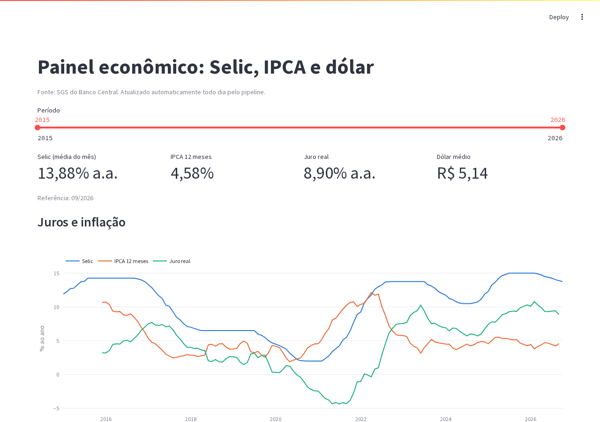

# Painel econômico: pipeline agendado + dashboard

Projeto integrador. O [pipeline ELT do Banco Central](https://github.com/LuissFellipe/pipeline-bcb) roda sozinho todo dia, e um dashboard lê as tabelas finais. Tudo sobe com um comando.

**Pergunta:** como juros, inflação e câmbio se comportaram desde 2015, e qual é o juro real hoje?



O mesmo pipeline também roda no GitHub Actions e publica uma página estática: https://luissfellipe.github.io/pipeline-bcb/. Aqui ele roda como serviço, com agendador próprio, e o GitHub Actions deste repositório confere a cada push que o `docker compose up` sobe tudo: o pipeline conclui a primeira execução, com os 19 testes do dbt, e o dashboard responde.

## Arquitetura

```
              ┌──────────────────── docker compose ─────────────────────┐
API SGS/BCB ──┼─► pipeline (agendador.py, todo dia às 08h)              │
              │     1. ingestão incremental ─► raw.sgs_series           │
              │     2. dbt build ─► staging ─► marts.fct_indicadores    │
              │     3. registra a execução ─► raw.execucoes             │
              │                     │                                   │
              │               postgres:16                               │
              │                     │                                   │
              │   dashboard (Streamlit) ◄─┘   http://localhost:8501     │
              └─────────────────────────────────────────────────────────┘
```

## Decisões técnicas

- **Agendador em Python em vez de Airflow**: para um único DAG de duas etapas, o Airflow adicionaria scheduler, webserver e um banco de metadados. O `agendador.py` faz o essencial: roda as etapas em ordem, para na primeira falha e grava cada execução em `raw.execucoes`, que o dashboard exibe.
- **Ingestão incremental**: cada execução pede ao BCB só os dias depois da última data gravada, e o `on conflict` torna a carga idempotente.
- **Testes de dados no dbt**: o `dbt build` falha antes de publicar uma tabela com dados quebrados. O principal compara o IPCA 12 meses de cada dezembro com o IPCA anual do IBGE.
- **Cópia do pipeline-bcb em `pipeline/`**: o código é o mesmo do [pipeline-bcb](https://github.com/LuissFellipe/pipeline-bcb). Só muda o endereço padrão do banco, que aqui é o serviço `postgres` do compose.
- **Sem eixo duplo**: Selic (%) e dólar (R$) ficam em gráficos separados. Num eixo duplo, a aparente relação entre as duas linhas dependeria só de como as escalas foram alinhadas.
- **Dashboard tolerante à primeira carga**: enquanto os marts não existem, o dashboard mostra um aviso em vez de quebrar.

## Como rodar

```bash
docker compose up -d --build
```

O dashboard fica em http://localhost:8501, e o Postgres em `localhost:5437`. Para acompanhar o pipeline, use `docker compose logs -f pipeline`. O horário da execução diária é definido por `HORA_EXECUCAO` no `docker-compose.yml`.
